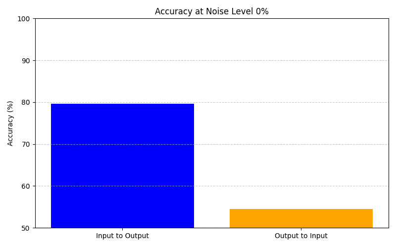
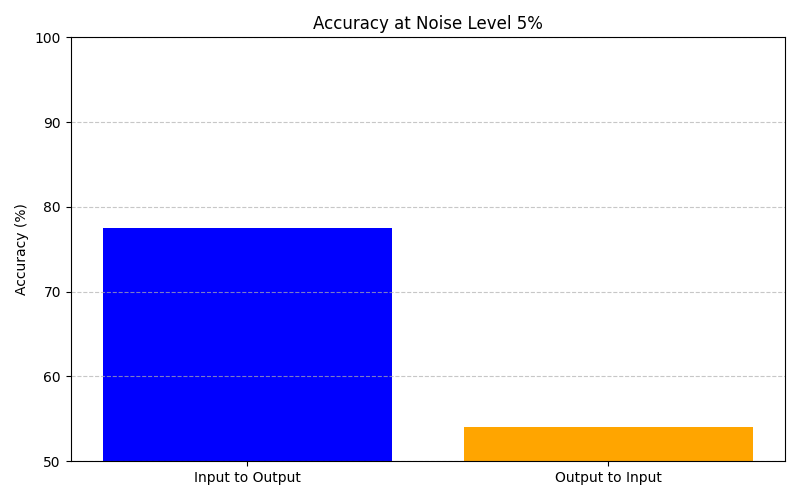
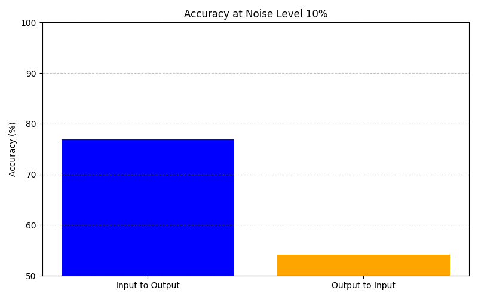
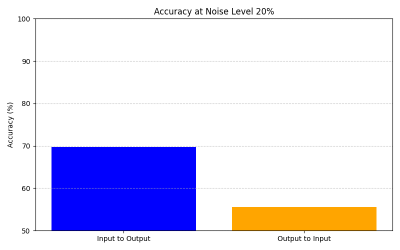

# BAM-Neural-Network-for-Associative-Memory
An end-to-end Python implementation of a **Continuous Bidirectional Associative Memory (BAM)** neural network built completely from scratch using NumPy.

The model associates 64-bit input patterns (representing English letters `A–Z`) with 7-bit output encodings and evaluates bidirectional recall robustness under varying levels of structural noise.

## Key Features
* **From-Scratch Architecture:** Implements Hebbian learning weight initialization (`np.outer` on bipolar representations) and continuous sigmoid activation dynamics without external deep learning frameworks.
* **Bidirectional Convergence:** Iterative forward (X to Y) and backward (Y to X) recall loops with dynamic convergence checking (`np.allclose`).
* **Noise Robustness Evaluation:** Stress-tests pattern reconstruction accuracy across multiple bit-flipping noise levels (`0%`, `5%`, `10%`, `20%`).
* **Performance Visualization:** Generates comparative accuracy bar charts using Matplotlib and structured summary reports via Pandas.

## Tech Stack
* **Python 3**
* **NumPy** (Matrix operations & vectorization)
* **Pandas** (Dataset ingestion & evaluation logging)
* **Matplotlib** (Accuracy visualization)

## Results & Performance
| 0% Noise | 5% Noise |
| :---: | :---: |
|  |  |

| 10% Noise | 20% Noise |
| :---: | :---: |
|  |  |  

## How to Run
1. Ensure `Letters_A-Z_BAM_Model_Data.csv` is in the same directory as the script.
2. Install dependencies:
   ```bash
   pip install numpy pandas matplotlib
3. Run the simulation:

   `python BAM_1.py`
